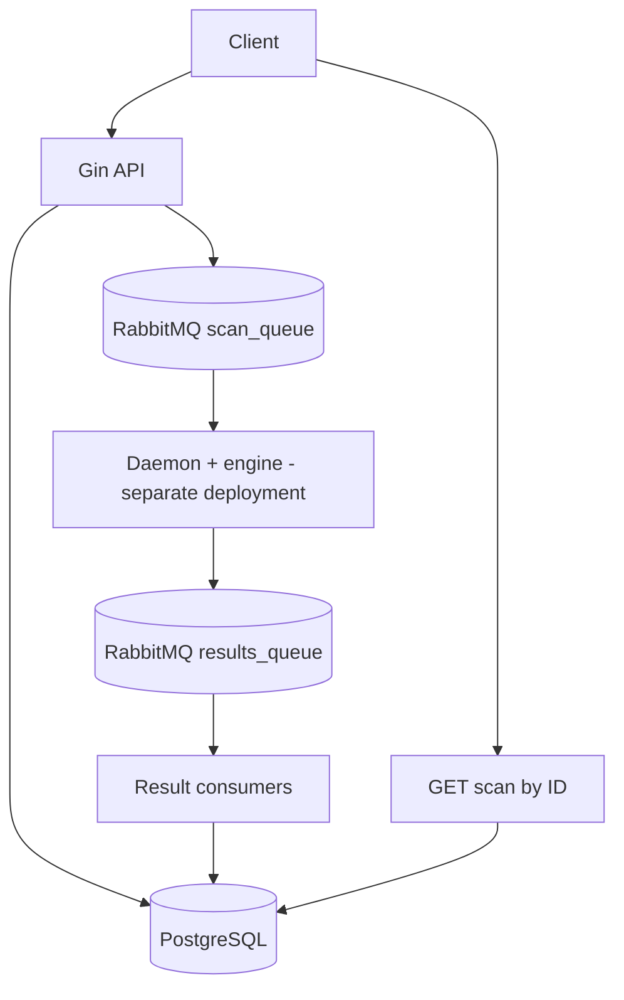

# ⚙️ Backend documentation

Backend-Antiginx is the HTTP orchestration layer for [engine-antiginx](https://github.com/prawo-i-piesc/engine-antiginx). Its entry point is `main.go`; it opens PostgreSQL and RabbitMQ connections, runs GORM migrations, declares broker topology and starts the Gin router on port `4000`.

## 🏗️ Request lifecycle

1. `POST /api/freescans` queues a public scan; `POST /api/scans` queues an authenticated user's scan with selected tests.
2. The backend saves a scan as `PENDING` and publishes a persistent JSON task through `main_exchange` / `scan_key` to `scan_queue`, waiting for the broker's publisher confirm.
3. The **daemon** consumes `scan_queue`, runs the engine and publishes every result to the results queue. The backend's result consumers save them in batches: the first result moves the scan `PENDING` → `RUNNING`, the end message (`endFlag`) marks it `COMPLETED`.
4. Clients poll `GET /api/freescans/:id` (public) or `GET /api/scans/:id` (owner only) for status and results.

`main.go` declares a quorum `scan_queue` that dead-letters through `scan_dlx` into `scan_dlq` and `scan_failed` after three deliveries, and the results queue. The backend reads `scan_failed` to mark scans the daemon could not run as `FAILED`. The backend does not execute security tests.

## 📁 Source map

| Path | Responsibility |
| --- | --- |
| `main.go` | Startup, migrations, RabbitMQ topology and server |
| `internal/api/router.go` | Route groups, CORS and response security headers |
| `internal/config/config.go` | Required settings and defaults |
| `internal/handlers/scan_handler.go` | Scan submissions, polling, dashboards |
| `internal/results/` | Results queue contract, batched consumers and storage |
| `internal/handlers/auth*_handler.go` | Registration, sessions, MFA, OAuth, passkeys, account operations |
| `internal/handlers/admin*_handler.go` | Admin dashboard widgets and operations on accounts and scans |
| `internal/stats/`, `internal/handlers/dashboard_handler.go` | Dashboard statistics, the risk score and saved preferences |
| `internal/monitoring/`, `internal/handlers/system_handler.go` | Admin System view: probes, scan queue, server load from Prometheus |
| `internal/billing/`, `internal/handlers/billing_handler.go` | Pro plan: Stripe Checkout, customer portal, subscription sync and webhook |
| `internal/models/` | Database models and JSON scan result types |
| `internal/auth/`, `middleware/` | Tokens, sessions, password policies, bearer and origin checks |

## 📚 Reference

- [Configuration](./Configuration.md) — environment, startup and deployment.
- [Scans and results](./Scans.md) — endpoints, task payload and results queue contract.
- [Authentication and account API](./Auth.md) — JWT, refresh sessions, MFA, OAuth, WebAuthn and admin routes.
- [Billing](./Billing.md) — the Pro plan, Stripe setup and how subscription state is kept current.
- [Dashboard statistics](./Dashboard.md) — chart and widget data, the risk score and saved preferences.
- [System status](./System.md) — probes, scan queue and server load from Prometheus for the admin panel.
- [Quick Start](../QuickStart/QuickStart.md) — local, Docker and Compose instructions.

!!! warning "Integration boundary"
    Results arrive only through RabbitMQ, so anyone who can publish to the results queue can write scan results. Keep the broker on a private network. Target ownership is not verified; restrict who can submit scan targets when deploying this service.
